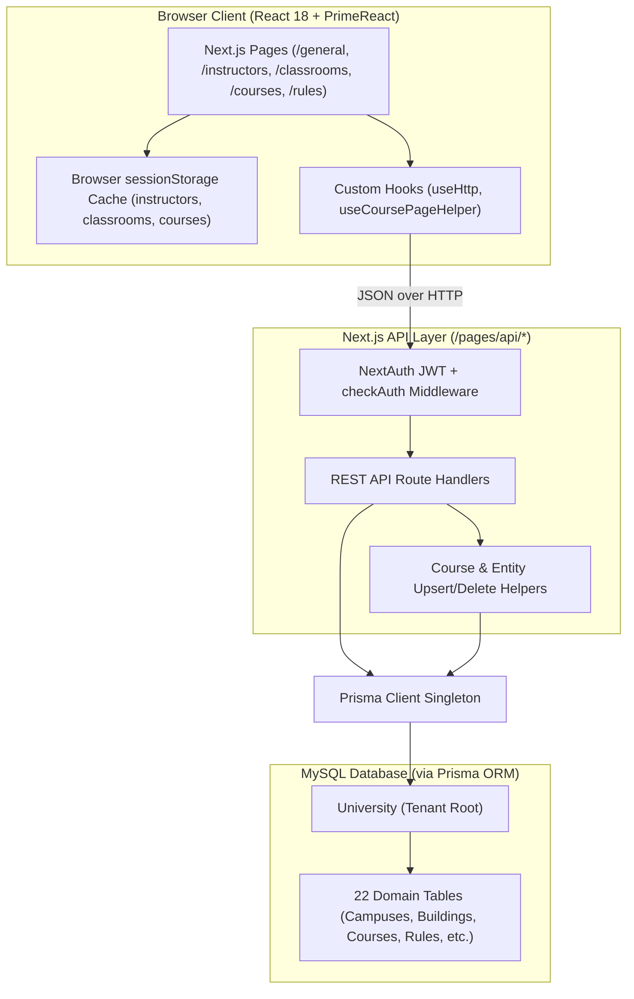

# Legacy Dynamic Website Documentation (Kitai Next.js)

This document provides a comprehensive technical reference for the legacy dynamic course-scheduling web application (**Kitai**, package name `kitai-nextjs`) prior to its replacement by the standalone **Defterdar** static scheduling workspace.

---

## 1. Executive Summary & Purpose

**Kitai** was a full-stack, multi-tenant university course scheduling data collection and constraint management application built with **Next.js (Pages Router)**, **React 18**, **Prisma ORM (MySQL)**, **NextAuth.js**, and **PrimeReact**.

Its primary purpose was to allow university administrators to:
1. Configure institutional hierarchy and physical infrastructure (**Campuses**, **Buildings**, **Faculties**, **Departments**, **Building Preference Scores**, **Classroom Types**, **Time Structures**, and **Inter-Campus/Inter-Building Travel Times**).
2. Manage **Classrooms** and their hourly availability/preference calendars.
3. Manage **Instructors**, their daily workload bounds (`minWorkHoursPerDay`, `maxWorkHoursPerDay`), assigned sections, and hourly availability/preference calendars.
4. Manage **Courses**, including lecture **Course Patterns** (e.g., `3+2`, `4+0`), **Sections** (with assigned instructor, classroom, day, start/end time, and student demand), **Recitation/Labs** (with schedule type and pattern), and **Percentage Distribution by Term** across faculties/departments.
5. Define scheduling constraints via **Standard Rules** (e.g., *Same Day*, *Different Time*, *Same Time*, *Different Day*) and **Order Rules** (*Before* / *After* relationships across courses, sections, and labs).

---

## 2. Technology Stack & Dependencies

| Layer | Technology | Version | Role |
| :--- | :--- | :--- | :--- |
| **Framework** | Next.js (Pages Router) | `^14.0.2` | SSR/CSR routing, dynamic pages, REST API routes (`/pages/api/*`) |
| **UI Library** | React / React DOM | `^18.2.0` | Component rendering and hooks |
| **Component Kit** | PrimeReact / PrimeFlex / PrimeIcons | `^10.6.6` / `^3.3.1` / `^6.0.1` | DataTables, Dialogs, Accordions, Dropdowns, Toast notifications (`saga-blue` theme) |
| **Secondary UI** | React-Bootstrap / React-Select | `^2.8.0` / `^5.7.4` | Auxiliary layout and select inputs |
| **Animations** | Framer Motion | `^11.2.12` | Page transitions (`AnimatePresence`, `Sliding`, `FadeIn`, `FadeInDown`, `FadeInUpBig`) |
| **Color Utilities** | Chroma.js | `^2.4.2` | Dynamic cell hover darkening in `ScheduleSelector` |
| **Authentication** | NextAuth.js (`next-auth`) | `^4.24.3` | Credentials authentication and JWT session management |
| **Database & ORM** | Prisma (`@prisma/client`, `prisma`) | `^5.5.2` | MySQL schema modeling, migrations, and query execution |
| **Testing** | Jest & React Testing Library | `^29.7.0` / `^16.0.1` | Unit and component testing in `jsdom` environment |

---

## 3. System Architecture

### Key Architectural Patterns

1. **Multi-Tenancy by `universityId`**:
   Every record in the database belongs to a `University` entity. When a user signs in via NextAuth, their `universityId` is embedded into the encrypted JWT token (`pages/api/auth/options.js`). Every API route extracts `universityId` via `getToken({ req, secret })` and scopes all Prisma `findMany`, `create`, `update`, and `delete` queries to that `universityId`.
2. **Client-Side `sessionStorage` Caching**:
   To reduce redundant API round-trips when navigating between list and edit pages, list views (`/classrooms`, `/instructors`, `/courses`) cache fetched payloads in `window.sessionStorage` under keys `"classrooms"`, `"instructors"`, and `"courses"`. Mutations update or invalidate these keys via `utils/helper/components/SessionStorageOperations.js`.
3. **Lazy-Loaded Accordion Sections**:
   In `/general`, each of the 8 configuration panels is loaded on demand via `next/dynamic(..., { ssr: false })` only when its `AccordionTab` is opened for the first time.

---

## 4. Database Schema (Prisma & MySQL)

The Prisma schema (`prisma/schema.prisma`) defines **23 models** and **4 enums** backed by MySQL (`DATABASE_URL`).

### 4.1 Enums

- **`DayOfWeek`**: `SUNDAY`, `MONDAY`, `TUESDAY`, `WEDNESDAY`, `THURSDAY`, `FRIDAY`, `SATURDAY`
- **`HourOfDay`**: `HOUR_00` through `HOUR_23`
- **`AvailabilityType`**: `PREFERRED`, `AVAILABLE`, `BUSY`
- **`FeedbackKind`**: `bug`, `improvement`

### 4.2 Models

#### Core Tenant & Authentication
- **`University`**:
  - `id` (PK, AutoIncrement), `name` (Unique String).
  - Parent relation to all institutional models.
- **`User`**:
  - `id` (PK), `email`, `password`, `name`, `surname`, `universityId` (FK → `University`).

#### Institutional & Spatial Structure
- **`Campus`**:
  - `id` (PK), `name`, `universityId` (FK).
  - Has many `Building`, `Classroom`, `CampusToBuildingTravelTime`, `CampusToCampusTravelTime` (as origin and destination).
- **`Building`**:
  - `id` (PK), `name`, `campusId` (FK → `Campus`), `universityId` (FK).
  - automatically initializes `BuildingScore` entries (default `0`) for all existing departments when created.
- **`Faculty`**:
  - `id` (PK), `name`, `universityId` (FK).
  - Has many `Department`, `Instructor`, `PercentageDistributionByTerm`.
- **`Department`**:
  - `id` (PK), `name`, `abbreviation`, `facultyId` (FK → `Faculty`), `universityId` (FK).
  - Automatically initializes `BuildingScore` entries (default `0`) for all existing buildings when created.
- **`BuildingScore`**:
  - `id` (PK), `departmentId` (FK), `buildingId` (FK), `score` (Int, `0–100`, default `0`), `universityId` (FK).
  - Unique composite constraint on `@@unique([departmentId, buildingId])`.
- **`TimeStructure`**:
  - `id` (PK), `dayOfWeek` (`DayOfWeek`), `startTime` (String, e.g., `"08:30"`), `endTime` (String, e.g., `"09:20"`), `universityId` (FK).
- **`CampusToCampusTravelTime`**:
  - `id` (PK), `fromCampusId` (FK), `toCampusId` (FK), `travelTime` (Int, minutes), `universityId` (FK).
- **`BuildingToBuildingTravelTime`**:
  - `id` (PK), `fromBuildingId` (FK), `toBuildingId` (FK), `travelTime` (Int, minutes), `universityId` (FK).
- **`CampusToBuildingTravelTime`**:
  - `id` (PK), `fromCampusId` (FK), `toBuildingId` (FK), `travelTime` (Int, minutes), `universityId` (FK).

#### Classrooms & Instructors
- **`ClassroomType`**:
  - `id` (PK), `name` (e.g., `"Amphitheater"`, `"Computer Laboratory"`), `universityId` (FK).
- **`Classroom`**:
  - `id` (PK), `code` (formatted as `<Campus>.<Building>.<RoomName>` or custom code), `name`, `minTimeBetweenClass` (Int), `capacity` (Int), `campusId` (FK), `buildingId` (FK), `classroomTypeId` (FK), `universityId` (FK).
- **`ClassroomAvailabilityCalendar`**:
  - `id` (PK), `classroomId` (FK), `day` (`DayOfWeek`), `hour` (`HourOfDay`), `availabilityType` (`AvailabilityType`), `universityId` (FK).
- **`Instructor`**:
  - `id` (PK), `email`, `name`, `surname`, `minWorkHoursPerDay` (Int), `maxWorkHoursPerDay` (Int), `departmentId` (FK), `facultyId` (FK), `universityId` (FK).
- **`InstructorAvailabilityCalendar`**:
  - `id` (PK), `instructorId` (FK), `day` (`DayOfWeek`), `hour` (`HourOfDay`), `availabilityType` (`AvailabilityType`), `universityId` (FK).

#### Courses, Sections & Labs
- **`CourseType`**:
  - `id` (PK), `name` (e.g., `"Compulsory"`, `"Faculty Elective"`), `universityId` (FK).
- **`Course`**:
  - `id` (PK), `code`, `name`, `departmentId` (FK), `universityId` (FK).
  - Has many `CoursePattern`, `PercentageDistributionByTerm`, `Section`, `RecitationLab`, and many-to-many links to `StandardRule`, `OrderRule`, `StructureRule`.
- **`CoursePattern`**:
  - `id` (PK), `courseId` (FK), `pattern` (String, e.g., `"3+2"`), `universityId` (FK).
- **`Section`**:
  - `id` (PK), `name` (e.g., `"CS101.01"`), `classroomId` (Optional FK → `Classroom`), `dayOfWeek` (Optional `DayOfWeek`), `startTime` (Optional String), `endTime` (Optional String), `demand` (Int), `instructorId` (FK → `Instructor`), `courseId` (FK → `Course`), `universityId` (FK).
- **`RecitationLab`**:
  - `id` (PK), `name` (e.g., `"CS101.LAB1"`), `classroomId` (Optional FK → `Classroom`), `scheduleType` (String, e.g., `"Weekly"`, `"Biweekly"`), `demand` (Int), `instructorId` (FK → `Instructor`), `courseId` (FK → `Course`), `universityId` (FK).
- **`RecitationLabPattern`**:
  - `id` (PK), `recitationLabId` (FK), `pattern` (String, e.g., `"0+2"`), `universityId` (FK).
- **`PercentageDistributionByTerm`**:
  - `id` (PK), `courseId` (FK), `termOrder` (String), `percentage` (Int), `facultyId` (FK), `departmentId` (FK), `universityId` (FK).

#### Scheduling Rules & Feedback
- **`StandardRule`**:
  - `id` (PK), `name`, `type` (e.g., `"Same Day"`, `"Different Time"`, `"Same Time"`, `"Different Day"`), `universityId` (FK).
  - Many-to-many relations: `courses`, `sections`, `recitationLabs`.
- **`OrderRule`**:
  - `id` (PK), `name`, `universityId` (FK).
  - Many-to-many relations: `beforeCourses`, `beforeSections`, `beforeRecitationLabs`, `afterCourses`, `afterSections`, `afterRecitationLabs`.
- **`StructureRule`**:
  - `id` (PK), `name` (Unique), `type`, `universityId` (FK), `courses` (M:N).
- **`SiteFeedback`**:
  - `id` (PK), `kind` (`FeedbackKind`), `summary` (VarChar 120), `details` (Text), `createdAt` (DateTime).

---

## 5. Authentication & Authorization

1. **NextAuth Configuration (`pages/api/auth/[...nextauth].js` & `pages/api/auth/options.js`)**:
   - Uses `CredentialsProvider` querying `prisma.user.findFirst({ where: { email, password } })`.
   - Configures JWT sessions (`maxAge: 86400` seconds / 1 day).
   - `jwt` and `session` callbacks attach `user.universityId` to both the token and `session.user.universityId`.
2. **Frontend Route Protection (`components/layout/Layout.js`)**:
   - All routes except `/` are wrapped in `<Layout>` inside `pages/_app.js`.
   - `Layout` checks `useSession()`. If unauthenticated, it renders `<NonAuthorized />` with a prompt to return to `/`.
3. **Backend API Route Protection (`utils/helper/api/checkAuth.js`)**:
   - Calls `getServerSession(req, res, authOptions)`.
   - Returns HTTP `401 Unauthorized` with a structured JSON error payload if no active session exists.

---

## 6. Frontend Pages & User Workflows

| Route | Source File | Description |
| :--- | :--- | :--- |
| `/` | `pages/index.js` | Checks screen dimensions (`>= 768x480`, otherwise renders `ResolutionError`). Shows `LoginForm` if unauthenticated or redirects to `/general` if authenticated. |
| `/general` | `pages/general/index.js` | Accordion-based administration page with 8 tabs: **Campuses**, **Buildings**, **Faculties**, **Departments**, **Score Building**, **Classroom Types**, **Time Structure**, and **Minimum Travel Time**. |
| `/instructors` | `pages/instructors/index.js` | Displays filterable `EntityTable` of all instructors (`email`, `instructor`, `faculty`, `department`). |
| `/instructors/add` | `pages/instructors/add/index.js` | Renders `Instructor` form in `"add"` mode with faculty/department dropdowns, min/max work hours, and `ScheduleSelector`. |
| `/instructors/edit/[instructorEmail]` | `pages/instructors/edit/[instructorEmail].js` | Loads instructor details, assigned sections table (`SectionTable`), and availability calendar for editing or deletion. |
| `/classrooms` | `pages/classrooms/index.js` | Displays filterable `EntityTable` of classrooms (`code`, `name`, `classroomType`, `campus`, `building`). |
| `/classrooms/add` | `pages/classrooms/add/index.js` | Renders `Classroom` form in `"add"` mode with campus/building tree, capacity, minimum turnaround time, and `ScheduleSelector`. |
| `/classrooms/edit/[className]` | `pages/classrooms/edit/[className].js` | Edits or deletes an existing classroom identified by its `code`. |
| `/courses` | `pages/courses/index.js` | Displays filterable `EntityTable` of courses (`code`, `name`, `department`). |
| `/courses/add` | `pages/courses/add/index.js` | Renders `Course` form in `"add"` mode using `useCoursePageHelper` to populate department, classroom, and instructor options. |
| `/courses/edit/[courseCode]` | `pages/courses/edit/[courseCode].js` | Fetches full course details (`/api/courses/[courseCode]`) including patterns, sections, recitation/labs, and term distributions. |
| `/rules` | `pages/rules/index.js` | Toolbar switcher between **Standard Rules** (`StandardRuleDialog`) and **Order Rules** (`OrderRuleDialog`), backed by `RuleInitializer` and `RuleTable`. |

---

## 7. Component Inventory (`components/`)

### 7.1 Layout, Navigation & Feedback
- `components/layout/Layout.js`: Main shell with sidebar `NavBar`, scrollable content container, and footer (`Datart © 2023`).
- `components/navigation/NavBar.js`: Left sidebar navigation with active indicator bar (`#19aa8d`), logo, links to `/general`, `/instructors`, `/classrooms`, `/courses`, `/rules`, and Sign Out button.
- `components/login/LoginForm.js`: Email/password sign-in form invoking `signIn("credentials", ...)`.
- `components/loading/SpinnerLoading.js`: Centered PrimeReact `ProgressSpinner`.
- `components/other/NonAuthorized.js` & `ResolutionError.js`: Guard screens for unauthenticated access and small viewports.

### 7.2 Interactive Availability Selector (`components/schedule-selector/`)
- `ScheduleSelector.jsx` & `style.module.css`:
  - Renders a 2D weekly hour grid (default Monday–Friday, 06:00–18:00 or 08:00–23:00).
  - Supports click-and-drag rectangular cell selection across three modes:
    - **Unavailable** (`#c83230` - Red)
    - **Available** (`#e39764` - Orange)
    - **Preferred** (`#15aa92` - Teal)
  - Maintains dual matrices (`tempAvailabilityMatrix` during drag and `availabilityMatrix` on mouse-up) and outputs `avalSet` and `prefSet` arrays of `{ day, hour, minute }` coordinates.

### 7.3 Generic Table & CRUD Form Abstractions (`components/table/`)
- `EntityTable.js`: Searchable, filterable PrimeReact `DataTable` used by `/instructors`, `/classrooms`, and `/courses` with an `Add` toolbar button and row click navigation to `/<entityType>/edit/<id>`.
- `GeneralTable.js` & `Helper.js`: Shared table wrapper with selection, search filter, add dialog trigger, and bulk delete action.
- `OneInputForm/`: Reusable CRUD table + modal for single-field entities (**Campuses**, **Faculties**, **Classroom Types**).
- `OneLabelOneInputForm/`: Inline numeric score editor table used for **Building Scores**.
- `OneSelectOneInputForm/`: Reusable CRUD table + modal for entities with one parent dropdown and one text input (**Buildings** under a Campus).
- `OneSelectTwoInputForm/`: Reusable CRUD table + modal for entities with one parent dropdown and two text inputs (**Departments** with Name + Abbreviation under a Faculty).
- `TwoSelectOneInputForm/`: Reusable CRUD table + modal for **Travel Times** (Origin selector, Destination selector, and travel time in minutes).

### 7.4 Domain Components
- **Building (`components/building/BuildingTable.js`)**: Configures buildings and links them to campuses.
- **Building Score (`components/building-score/BuildingScore.js`)**: Selects a department and edits its `0–100` preference scores for each building.
- **Classroom (`components/classroom/`)**: `Classroom.js`, `ClassroomForm.js`, `CalendarAndAttribute.js`.
- **Course (`components/course/`)**:
  - `Course.js`, `CourseForm.js`, `CourseAccordion.js`.
  - `Sections/`: `Sections.js`, `SectionsTable.js`, `SectionsDayAndTimeDialog.js` (assigns section name, instructor, classroom, demand, day of week, start/end times).
  - `RecitationLab/`: `RecitationLab.js`, `RecitationLabTable.js` (assigns lab name, schedule type, pattern chips, demand, instructor, classroom).
  - `PercentageDistribution/`: `PercentageDistribution.js`, `PercentageDistributionTable.js` (assigns faculty, department, term order, and student percentage).
- **Department (`components/department/DepartmentTable.js`)**: Manages departments per faculty.
- **Instructor (`components/instructor/`)**: `Instructor.js`, `InstructorForm.js`, `CalendarAndSections.js`, `SectionTable.js`.
- **Rule (`components/rule/`)**: `RuleInitializer.js`, `RuleTable.js`, `RuleTableForm.js`, `Helper.js`, `StandardRule/StandardRuleDialog.js`, `OrderRule/OrderRuleDialog.js`.
- **Time Structure (`components/time-structure/`)**: `TimeStructure.js`, `TimeStructureDayStack.js`, `TimeStructureDayDialog.js` (manages daily teaching time intervals per weekday).
- **Travel Time (`components/travel-time/`)**: `TravelTime.js`, `TravelTimeAccordion.js` (manages Campus-to-Campus, Building-to-Building, and Campus-to-Building travel times).

---

## 8. Backend REST API Reference (`pages/api/`)

All endpoints (except `/api/auth/*` and `/api/feedback`) require a valid NextAuth session and scope data to the authenticated user's `universityId`.

| Endpoint | Methods | Summary |
| :--- | :--- | :--- |
| `/api/auth/[...nextauth]` | `GET, POST` | NextAuth authentication handler. |
| `/api/campus` | `GET, POST, DELETE` | List, create, or delete campuses (blocks deletion if buildings reference the campus). |
| `/api/building` | `GET, POST, DELETE` | List, create (auto-creates `BuildingScore` rows for all departments), or delete buildings. |
| `/api/building/campus` | `GET` | Returns campuses grouped with their buildings for dropdown selectors. |
| `/api/faculty` | `GET, POST, DELETE` | List, create, or delete faculties. |
| `/api/faculty/department` | `GET` | Returns faculties with nested departments. |
| `/api/faculty/department/course` | `GET` | Returns faculties → departments → courses hierarchy. |
| `/api/faculty/department-tree` | `GET` | Returns PrimeReact TreeSelect-compatible faculty/department tree. |
| `/api/department` | `GET, POST, DELETE` | List, create (auto-creates `BuildingScore` rows for all buildings), or delete departments. |
| `/api/department/building-scores` | `GET, PUT` | Fetch or bulk-update department-to-building preference scores. |
| `/api/classroom` | `GET, POST, PUT, DELETE` | Full CRUD for classrooms and their `ClassroomAvailabilityCalendar` slots. |
| `/api/classroom/[id]` | `GET` | Fetch single classroom by `code` including building, campus, type, and availability calendar. |
| `/api/classroom/type` | `GET, POST, DELETE` | List, create, or delete classroom types. |
| `/api/classroom/tree` | `GET` | Returns classrooms grouped by classroom type or building for course section selection. |
| `/api/instructors` | `GET, POST, PUT, DELETE` | Full CRUD for instructors and their `InstructorAvailabilityCalendar` slots (blocks deletion if assigned to sections/labs). |
| `/api/instructors/[email]` | `GET` | Fetch single instructor by email, including assigned sections/labs and availability calendar. |
| `/api/instructors/faculty` | `GET` | Returns instructors grouped by faculty/department. |
| `/api/courses` | `GET, POST, PUT, DELETE` | Full CRUD for courses, cascading creations/updates/deletions across `CoursePattern`, `Section`, `RecitationLab`, `RecitationLabPattern`, and `PercentageDistributionByTerm`. Blocks deletion if referenced by any rule. |
| `/api/courses/[courseCode]` | `GET` | Fetch complete course aggregate by `courseCode`. |
| `/api/courses/sections` | `GET` | Fetch sections for rule and instructor views. |
| `/api/courses/type` | `GET` | Fetch course types (`Compulsory`, `Faculty Elective`, etc.). |
| `/api/time-structure` | `GET, POST, DELETE` | Manage daily time slot intervals (`dayOfWeek`, `startTime`, `endTime`). |
| `/api/travel-time/campus-campus` | `GET, POST, DELETE` | CRUD for `CampusToCampusTravelTime`. |
| `/api/travel-time/building-building` | `GET, POST, DELETE` | CRUD for `BuildingToBuildingTravelTime`. |
| `/api/travel-time/building-campus` | `GET, POST, DELETE` | CRUD for `CampusToBuildingTravelTime`. |
| `/api/rule` & `/api/rule/tree` | `GET` | Fetch selectable hierarchy of courses, sections, and recitation labs for rule dialogs. |
| `/api/standard-rule` | `GET, POST, PUT, DELETE` | Full CRUD for `StandardRule` records connecting courses, sections, and labs. |
| `/api/order-rule` | `GET, POST, PUT, DELETE` | Full CRUD for `OrderRule` records connecting `before*` and `after*` courses, sections, and labs. |
| `/api/structure-rule` | `GET, POST, PUT, DELETE` | CRUD for `StructureRule` records. |
| `/api/feedback` | `GET, POST` | Public endpoint for reading the latest 50 `SiteFeedback` entries and submitting new bug/improvement items. |

---

## 9. Custom Hooks, Utilities & Seeding

### 9.1 Hooks (`hooks/`)
- **`use-http.js`**: Returns `[isDataAvailable, sendRequest]`, wrapping `fetch` with automatic JSON serialization/parsing and error flag propagation.
- **`use-http-with-notice.js`**: Wraps `fetch` with SweetAlert2 loading/error/confirmation dialogs, including cascade-delete confirmation when a `"Foreign Key Constraint Error"` is returned.
- **`use-course-page-helper.js`**: Parallel loader fetching `/api/faculty/department-tree`, `/api/classroom/tree`, `/api/courses/type`, and `/api/instructors/faculty` for the Course Add/Edit forms.

### 9.2 Helpers (`utils/helper/`)
- **`api/checkAuth.js`**: Server-side session validator.
- **`classroom/updateCourse.js`**: Modular diffing and upsert/delete functions for course sub-entities (`upsertCoursePatterns`, `deleteCoursePatterns`, `upsertPercentageDistributon`, `deletePercentageDistributon`, `upsertSections`, `deleteSections`, `upsertRecitationLab`, `deleteRecitationLabs`).
- **`components/ErrorHandling.js`**: Displays PrimeReact `Toast` error notifications.
- **`components/SessionStorageOperations.js`**: Helpers (`removeEntityFromSessionStorage`, `createUpdatedEntityCredentials`, `saveUpdatedEntityToSessionStorage`) to keep browser `sessionStorage` synchronized after mutations.

### 9.3 Database Seeding (`prisma/seed.js`)
- Populated a complete demonstration tenant (`"Metropolitan University of Technology"`) with:
  - Admin credentials (`admin@example.com` / `admin`)
  - 2 Campuses (*North Engineering Campus*, *South Arts & Sciences Campus*) and 25-minute travel times
  - 4 Buildings (*Turing Hall*, *Tesla Engineering Lab*, *Newton Science Complex*, *Aristotle Humanities Hall*)
  - 2 Faculties and 4 Departments (`CS`, `EE`, `MATH`, `PHYS`) with Building Scores
  - 4 Classroom Types, 3 Course Types, and 8 daily `TimeStructure` slots (`08:30`–`17:20`, Monday–Friday)
  - 9 Classrooms and 9 Instructors (e.g., Alan Turing, Grace Hopper, Donald Knuth, Claude Shannon, Ada Lovelace) with availability calendars
  - 5 Courses (`CS101`, `CS201`, `MATH101`, `EE101`, `PHYS101`) with sections, labs, patterns, term distributions, Standard Rules, and Order Rules.

### 9.4 Testing (`__tests__/`)
- Configured via `jest.config.js` using `next/jest` and `jest-environment-jsdom`.
- Included component unit tests for `ChipForm` (`__tests__/form/ChipFormTest.js`), `GeneralTable` (`__tests__/table/GeneralTable.js`), `OneInputForm`, `OneLabelOneInputForm`, `OneSelectOneInputForm`, and `OneSelectTwoInputForm`.

